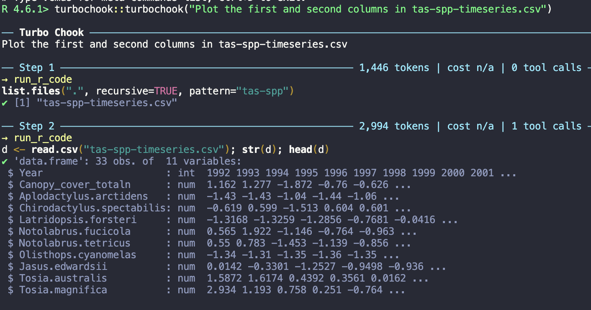

It's really easy to make your own agent. You should do it once, just to understand how this technology works.

LLM agents are becoming pervasive, with Meta's Muse perhaps the first consumer grade agent. They are only going to get more common. If you know a bit of R you can program your own, and it makes the whole thing feel a lot less like magic.

I've updated my live book with [a new section on making your own agent with R](https://www.seascapemodels.org/AI-assistants-for-scientific-coding/section-7-api-access/05-make-an-agent.html).

The tutorial runs you through using the `ellmer` package to connect to an LLM. Then you create tools. These are functions that let the agent take actions, like writing and running R code. You tell the agent how to use the functions, then write a parser that checks the LLM response for tool use and executes the tools if it finds any. Then you put all that in a `while` loop so the agent re-consumes the output of the code it wrote.

That's it.

This all runs more smoothly if you 'register' tools formally, because the agent is less likely to make syntax mistakes when using them. `ellmer` supports this.

## turbochook

To illustrate the registered tools approach I made an R based agent (with Claude Code) in a package called `turbochook`. [You can install it from github](https://github.com/cbrown5/turbochook).

There are many [R based agents out there already](https://luisdva.github.io/llmsr-book/r-pkgs.html#language-model-agents-and-ai-assistants). I wanted my own that was simple enough for experimentation and learning.

There are three main functions:

- `handfish()` is for beginners and the security conscious. It is simpler and requires manual approval at every step.
- `turbochook()` runs an agentic loop autonomously. It won't ask for permission, it just acts.
- `ralph()` runs a ralph loop (basically a self completing todo list).

*turbochook in action in my R console*

This is very much alpha stage software. Like all agents, there is no cybersecurity guarantee with these tools, so use them with caution. It's best to run them in a sandbox or isolated container.

What I wanted was a simple and transparent agent. They all print progress as they go, including tool use and tokens used, so you can see exactly what the agent is doing. Everything is written in R, so R users will find it easier to interpret than commercial agents like Claude Code, which often write in unix or python.

If you give it a go, send me feedback here or via the github repo.
