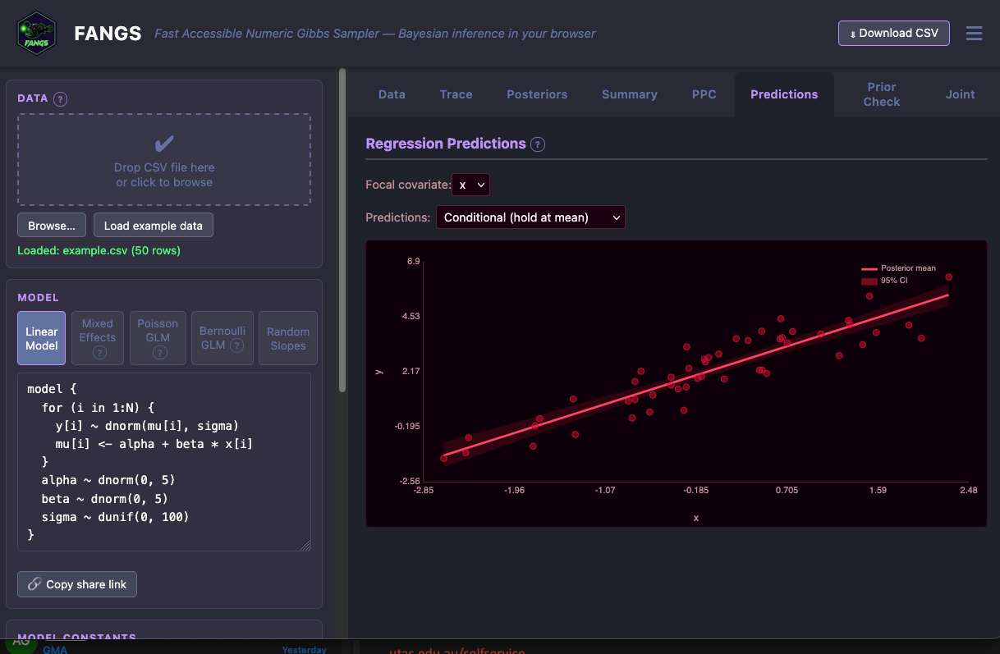

I recall when the R shiny framework first came out. It suddenly got relatively easy for us ecological modellers and environmental statisticians to turn our R code into web apps. This improved accessibility of complex analyses to more general audiences.

You started seeing ‘web apps’ popping up as outcomes of all sorts of projects. (Here’s one great example, [Biological Ocean Observer](https://shiny.csiro.au/BioOceanObserver/) let’s you analyse timeseries of plankton data from Australia).

The barrier to doing these apps before was that most of the modelling community didn’t know how to code in the languages of the web. An R based framework for web apps made that possible.

But there was still a downside. With R shiny you still need to host the R code on a server somewhere. This requires either a free, but limited account, or paying for compute.

The ideal situation is to have your app written in Java Script and html. These languages run web pages. The key difference from R Shiny is the computations run in the web browser, on the viewer’s computer. This means you can host a web page cheaply or for free (e.g. as a github page). No server for computing R required.

Back in 2018, we paid a JS programmer to turn my R code into a web app for one of our projects ([on projecting carbon emissions from mangrove deforestation](https://mangrove-carbon.wetlands.app/)). This app become very useful for people assessing potential outcomes of carbon projects.

Well AI coding agents have removed that barrier coding in JS.

I don’t think the huge potential of this change is widely appreciated in the environmental data analysis and modelling community yet. So I wanted to call it out here.

The tech community itself is only just starting to appreciate the impacts of this change. [Here's a nice explanation](https://ftrain.com/aboard-the-web-is-more-than-enough) of how this new power of running apps in the browser is transformative for the tech industry. (Check out [tinylittleoffice](https://tinylittleoffice.com/), a browser based office suite that saves the document as a URL you can copy and paste, or [Battle Drones](https://simonw.github.io/battledrones/) a multiplayer web game that connects two devices through sound and microphones!).

This change is also going to be transformative for modelling and communication of science.

I got inspired by examples like those in the post above, and set-off on my own AI coding experiment. The result is [FANGS](https://www.seascapemodels.org/FANGS/), a browser based Bayesian computation engine.

Brief background on my motivation here. I’m a huge fan of Bayesian statistics. More people should be using it. But a barrier to sharing that enthusiasm is the complexity of installing many Bayesian R packages on other people’s computers.

So I built (vibe coded) FANGS as an educational tool. It means my students can write and run simple Bayesian models, directly in their browsers. This means that in a 3 hour lesson I can: cover an intro to Bayesian concepts, have students write models in R like syntax, run the models and interpret the results.

The idea is that is enough to get them motivated to then install the proper R software. The use of model syntax that emulates the serious Bayesian R packages is also a stepping stone to the more powerful R software.

I’ll write up the development pipeline in a later post. But I just want to say it blew me away how well this experiment with vibe coding worked. FANGS gets you the right answers and runs faster on small teaching scale problems than the equivalent R packages.

I think this new power will revolutionize scientific communication and education, through improving accessibility of many types of data and science.

What does this new wave of scientific app development what do you need?

On a personal level, curiosity about what is possible in web browsers. Once you know something is possible its easy to get an AI agent to make it. Once I learned about saving data in URLs from the tinylittleoffice example, it was easy to ask Claude to implement that feature in FANGS (see the `copy share link` button).

On a community level, translating more of the most common R packages to Java Script libraries will help. I actually haven’t fully explored what is available in JS yet. But for example, efficient JS packages for mapping exist, extending those for complex GIS operations will extend the potential of our apps.

Standards for validation. When you vibe code a package, you need to know it is accurate. I’ll come to how to do this when I write up the FANGS development process.

Finally, a bottleneck with apps has always been user experience (UX). For any scientific application a key question for me has always been: how do we make sure users don’t misinterpret the information this app provides? I’m not sure AI can solve that problem yet. It requires thoughtful design and lots of testing.

Let me know cool ideas you have or have seen, I’m keen to see more examples.